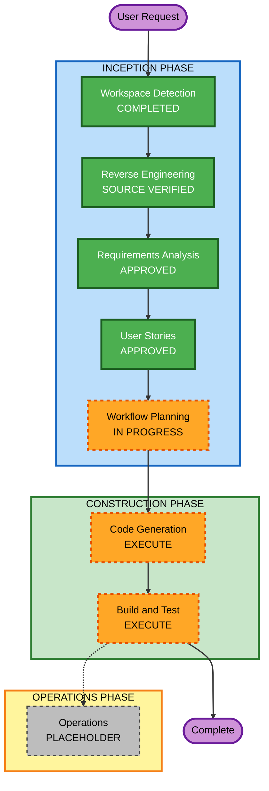

# Workflow Execution Plan - Bioengineering Portfolio

## Detailed Analysis Summary

### Transformation Scope

- **Transformation type**: Multi-section user-facing portfolio customization with presentation consolidation.
- **Primary changes**: Replace the existing identity and content; create a single Bioengineering presentation; remove Business template selection and implementation; add curated evidence assets and research-led visual styling.
- **Related components**: App orchestration, template registry and types, section components, typed content data, CSS, tests, project metadata, and active documentation.
- **Source verification**: Current TypeScript code supports Engineering and Business templates; some older reverse-engineering documents describe a retired Neutral template and are stale. Current source code and tests are authoritative. Relevant architecture and setup documentation will be refreshed as part of code generation.

### Change Impact Assessment

- **User-facing changes**: Yes. The entire portfolio identity, content hierarchy, colors, section labels, and public template selection change.
- **Structural changes**: Yes. The two-template registry and selector are replaced by one named Bioengineering presentation; shared section and layout behavior remains.
- **Data model changes**: No new domain model. Existing typed portfolio structures will be reused and only extended if a required source-grounded content pattern cannot be represented cleanly.
- **API changes**: None. The site remains static and has no backend.
- **NFR impact**: Preserve responsive behavior, keyboard accessibility, color-mode readability, reduced-motion support, and static GitHub Pages compatibility.

### Component Relationships

- **Primary component**: React/Vite portfolio application in `src/`.
- **Shared content**: Typed modules under `src/data/` feed section components under `src/components/`.
- **Presentation**: `src/templates/` provides the single Bioengineering shell and registry contract.
- **Supporting behavior**: Layout and hash navigation in `src/hooks/` and `src/utils/` remains unless a helper exists solely for the removed template selector.
- **Deployment**: `.github/workflows/deploy.yml` and Vite base-path configuration remain unchanged.
- **Change type**: Coordinated changes within the one application package.
- **Dependency constraints**: No new runtime dependencies; user-facing selectors and template-selection persistence are removed together with their tests.

### Risk Assessment

- **Risk level**: Medium. Many existing data and UI surfaces contain the old owner's content, and selector removal affects App and template contracts.
- **Rollback complexity**: Easy through normal version control; no external state or infrastructure changes.
- **Testing complexity**: Moderate. Validate all portfolio data, single-template resolution, routing/layout behavior, responsive and accessible rendering, and no stale rendered identity.
- **Historical documentation**: Preserve append-only `audit.md` and prior paused workflow artifacts. Remove stale references from active application code, the public README, and current guidance; historical records may retain prior names as history.

## Workflow Visualization

### Text Alternative

INCEPTION, approved Code Generation, and Build and Test are complete. The portfolio and production bundle passed the documented checks; the Build and Test review gate is pending. Operations remains the standard future placeholder.

## Phases to Execute

### INCEPTION

- [x] Workspace Detection - Brownfield React/Vite portfolio and source materials identified.
- [x] Reverse Engineering - Current app, data, template, navigation, and deployment structure checked directly; older generated docs are not treated as authoritative where they conflict.
- [x] Requirements Analysis - Source-based requirements and user decisions approved.
- [x] User Stories - Seven stories and three personas generated and approved.
- [x] Workflow Planning - Approved by the user on 2026-10-12.
- [x] Application Design - SKIP. No new service, component boundary, or interaction architecture is needed; the approved research-led hierarchy and editorial visual direction are sufficient.
- [x] Units Planning and Generation - SKIP. One coordinated static-application deliverable; decomposition would add process without reducing dependency risk.

### CONSTRUCTION

- [x] Functional Design - SKIP. No new business rules or domain model; the approved source-grounded content and story acceptance criteria define the behavior.
- [x] NFR Requirements and Design - SKIP. Accessibility, responsive behavior, contrast, motion, and deployment constraints are explicit in approved requirements; existing platform patterns are retained.
- [x] Infrastructure Design - SKIP. No hosting, network, backend, or deployment change.
- [x] Code Generation - EXECUTE (ALWAYS). Produce the personalized portfolio, consolidate template behavior, update tests and directly related documentation.
- [x] Build and Test - COMPLETE (ALWAYS). The complete suite, lint, production build, and local browser smoke checks passed; review is pending.

### OPERATIONS

- [x] Operations - PLACEHOLDER. No deployment or monitoring change is requested.

## Code Generation Unit

### Unit 1: Bioengineering Portfolio Customization

1. Remove the Business presentation, runtime selector, and template-selection persistence; rename the remaining public template identity to Bioengineering and preserve section routing and layout modes.
2. Replace portfolio content and links using the approved name, resume, and Evidence Library; remove old-owner content and avoid publishing unsupported or private contact details.
3. Implement the warm-neutral and botanical-green editorial visual system with clear research-first hierarchy and responsive, accessible section presentations.
4. Refresh applicable portfolio tests, root README instructions, page metadata, and source-verified architecture/component documentation.
5. Verify supplied asset usage and confirm no old identity remains in active UI, code, or current guidance.

## Build and Test Strategy

- Run focused Vitest coverage for the App, navigation/data, single-template registry, layout, and accessibility.
- Run the complete `npm test` suite.
- Run `npm run lint`.
- Run `npm run build` to validate TypeScript and the Vite static bundle.
- Run the local site and inspect the desktop and mobile layouts, primary navigation, color modes, and contact placeholder in a browser.
- Confirm the GitHub Pages workflow and environment-driven base path are unchanged.

## Success Criteria

- The deployed experience is a single, coherent, research-led bioengineering portfolio for Nguyễn Lê Khôi.
- Resume and evidence are represented accurately; no old owner identity or false claims remain in active code or rendered pages.
- Business template code and public selector support are removed, while section, layout, theme, and deployment behavior remain reliable.
- Tests, lint, TypeScript, production build, and browser checks pass.

## Extension Compliance

| Extension | Status | Rationale |
|---|---|---|
| Security Baseline | N/A | Disabled by user choice during Requirements Analysis. |
| Property-Based Testing | N/A | Disabled by user choice during Requirements Analysis. |
