# Portfolio Restart — Execution Plan

Status: Execution plan approved by the user (“approve and continue”).

## Context and impact

Approved requirements and eight approved stories guide a scientific editorial portfolio for Lê Nguyên Khôi. One React/TypeScript/Vite package provides Chakra UI sections, typed src/data modules, hash navigation, layout/color modes and Engineering/Business templates. Existing reverse-engineering context is reused with a correction: the actual registry has two templates, while older documents mention a third Neutral template.

Transformation: frontend content and visual customization plus simplification to one presentation. No backend, database, hosting, external API or dependency change is planned. Existing gallery records and dialog boundaries can support certificate images; adapt current contracts only as needed. No new domain model or complex business rules are required.

Risk: medium, because content, routing/template simplification, media and styles cross components. Main regression risks are unsupported claims, stale former-owner routes, evidence readability/focus behavior and navigation/display controls. Version control provides straightforward rollback. Prior model work is backed up at /private/tmp/khoi-other-model-backup-20261013T110835Z.zip.

## Component relationships and sequence

| Order | Boundary | Change and dependency |
| --- | --- | --- |
| 1 | Supplied sources and src/assets | Inspect remaining scans and EthicsAI paper; prepare correctly oriented evidence previews and original scientific graphics |
| 2 | src/types/portfolio.ts and src/data | Adapt existing contracts and replace former-owner content using inspected sources |
| 3 | src/templates, src/App.tsx and selector utilities | Keep one dedicated presentation, remove alternate template/selection behavior, preserve supported routes and layout modes |
| 4 | src/components and shared UI | Customize introduction, selected work, academics, enterprise and evidence using current section/gallery/dialog boundaries |
| 5 | src/index.css, src/App.css, index.html and public | Scientific editorial styles, responsive layout, identity metadata and favicon |
| 6 | Existing tests and maintenance documents | Verify final interactions and content; update obsolete template tests and document source/editing guidance |
| Preserve | GitHub Pages workflow and Vite build configuration | Retain static delivery compatibility |

Use one implementation unit, portfolio-restart, and a sequential update approach. Source inspection precedes final copy; data contracts precede consumers; complete supported UI integration before verification. No multi-package coordination or agent delegation is needed.

## Stage decisions

| Stage | Decision | Rationale |
| --- | --- | --- |
| Workspace Detection | COMPLETE | Foundation restored, sources preserved |
| Reverse Engineering | REUSED | Existing artifacts and actual two-template boundary verified |
| Requirements Analysis | APPROVED, standard | Content, audience, evidence and constraints resolved |
| User Stories | APPROVED, standard | Eight stories and four personas mapped to requirements |
| Workflow Planning | COMPLETE, standard; review pending | This execution plan |
| Application Design | SKIP | Existing App, template, section and gallery/dialog boundaries suffice; no new service layer |
| Units Generation | SKIP | One frontend package and implementation unit |
| Functional Design | SKIP | Content and UI adaptation, no new domain model or complex algorithms/business rules |
| NFR Requirements | SKIP | Approved requirements already define accessibility, responsiveness, static delivery and asset loading; stack fixed |
| NFR Design | SKIP | Existing dialog, color-mode and CSS mechanisms support requirements; targeted improvements fit code planning |
| Infrastructure Design | SKIP | No hosting or infrastructure change |
| Code Generation | EXECUTE, standard | Detailed numbered plan, approval, implementation of all eight stories |
| Build and Test | EXECUTE, standard | Integrated checks and instructions with actual results |
| Operations | PLACEHOLDER | Local delivery; publication outside scope |

Skipped stages do not waive relevant requirements: source accuracy, certificate focus restoration, readable evidence, lazy loading and responsive contrast remain part of implementation and verification. The user may add any skipped stage or change the proposed workflow.

## Workflow visualization

```mermaid
flowchart TD
    WD["Workspace Detection - COMPLETE"]
    RE["Reverse Engineering context - REUSED"]
    RA["Requirements - APPROVED"]
    US["User Stories - APPROVED"]
    WP["Workflow Planning - REVIEW"]
    AD["Application Design - SKIP"]
    UG["Units Generation - SKIP"]
    FD["Functional Design - SKIP"]
    NR["NFR Requirements - SKIP"]
    ND["NFR Design - SKIP"]
    ID["Infrastructure Design - SKIP"]
    CG["Code Generation - EXECUTE"]
    BT["Build and Test - EXECUTE"]
    OP["Operations - PLACEHOLDER"]
    WD --> RE
    RE --> RA
    RA --> US
    US --> WP
    WP --> AD
    AD --> UG
    UG --> FD
    FD --> NR
    NR --> ND
    ND --> ID
    ID --> CG
    CG --> BT
    BT --> OP
    style WD fill:#4CAF50,stroke:#1B5E20,stroke-width:3px,color:#fff
    style RE fill:#4CAF50,stroke:#1B5E20,stroke-width:3px,color:#fff
    style RA fill:#4CAF50,stroke:#1B5E20,stroke-width:3px,color:#fff
    style US fill:#4CAF50,stroke:#1B5E20,stroke-width:3px,color:#fff
    style WP fill:#4CAF50,stroke:#1B5E20,stroke-width:3px,color:#fff
    style AD fill:#BDBDBD,stroke:#424242,stroke-width:2px,stroke-dasharray:5 5,color:#000
    style UG fill:#BDBDBD,stroke:#424242,stroke-width:2px,stroke-dasharray:5 5,color:#000
    style FD fill:#BDBDBD,stroke:#424242,stroke-width:2px,stroke-dasharray:5 5,color:#000
    style NR fill:#BDBDBD,stroke:#424242,stroke-width:2px,stroke-dasharray:5 5,color:#000
    style ND fill:#BDBDBD,stroke:#424242,stroke-width:2px,stroke-dasharray:5 5,color:#000
    style ID fill:#BDBDBD,stroke:#424242,stroke-width:2px,stroke-dasharray:5 5,color:#000
    style CG fill:#4CAF50,stroke:#1B5E20,stroke-width:3px,color:#fff
    style BT fill:#4CAF50,stroke:#1B5E20,stroke-width:3px,color:#fff
    style OP fill:#BDBDBD,stroke:#424242,stroke-width:2px,stroke-dasharray:5 5,color:#000
    linkStyle default stroke:#333,stroke-width:2px
```

Text alternative: Workspace Detection complete; Reverse Engineering context reused; Requirements and User Stories approved; Workflow Planning review pending. Skip Application Design, Units Generation, Functional Design, NFR Requirements, NFR Design and Infrastructure Design. Execute Code Generation planning and implementation, then Build and Test. Operations remains a placeholder.

## Execution tracking

- [x] 1. Load approved requirements, answers, stories, personas and foundation context.
- [x] 2. Assess component impact, reuse, dependencies and risk.
- [x] 3. Select stages and document skip rationale.
- [x] 4. Validate workflow visualization and include a text alternative.
- [x] 5. Prepare execution plan, update state and log review prompt.
- [x] 6. Obtain explicit execution-plan approval.
- [x] 7a. Create the numbered Code Generation plan for portfolio-restart.
- [x] 7b. Obtain approval of the complete Code Generation plan.
- [x] 8. Implement approved code-plan steps and update each checkbox immediately.
- [x] 9. Present completed code for required review.
- [ ] 9a. Receive Code Generation review approval.
- [ ] 10. Execute Build and Test; produce build, unit, integration, performance instructions and summary.
- [ ] 11. Present Build and Test review; Operations remains placeholder.

## Deliverables and verification

Deliver one local portfolio with warm ivory, deep green, varied scientific editorial compositions and illustrations connected to microbiology, water quality and quantitative work. Retain a complementary entrepreneurship narrative, evidence summaries and certificate previews, résumé download and the neutral contact placeholder.

Verify all eight stories and AC-01–AC-08. Check source accuracy and project maturity, absence of former-owner content in reachable routes and metadata, one presentation, evidence opening/closing and keyboard focus restoration, supported navigation/layout modes and both color modes. Run meaningful existing/updated Vitest tests, required lint and the production build. Inspect asset sizes and secondary-image lazy loading rather than introduce performance tooling.

Use local browser preview if available under the Sites skill's local-preview guidance; report unperformed checks or tool limits honestly. Preserve source assets, document editing paths and the public/source-name discrepancy, and report existing bundle warnings if retained. No deployment, git push or public Site creation is included.

## Question 1 — Execution plan review

Approve the recommended workflow?

A) Approve this plan and continue to Code Generation planning
B) Request changes or add a skipped stage (describe after [Answer]:)
C) Other (describe after [Answer]:)

[Answer]: A — approved by “approve and continue”.

## Extension compliance and content validation

Security Baseline: N/A, disabled in current state. Property-Based Testing: N/A, disabled. Full disabled rules remain unloaded.

Mermaid node IDs, quoted labels, connections and referenced styles validated against a restricted flowchart syntax before writing; text alternative included. Markdown fences, tables and question format checked. No ASCII diagrams used. An initial validator rejected an identifier-only reference during preparation; the diagram was regenerated with explicit node declarations and revalidated successfully before file creation.
